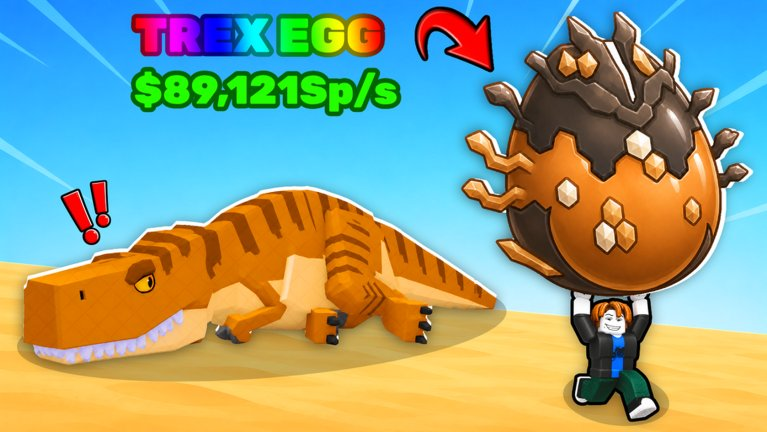

**스틸 언 에그**(Steal An Egg)는 동물들이 지키는 알을 몰래 훔쳐서 펫으로 키우고, 그 펫으로 돈 버는 로블록스 게임이야. 11월 6일 기준 동시접속자가 130만 명이 넘어서 지금 로블록스에서 제일 많이 하는 게임임.

*이미지: 로블록스 'Steal An Egg' 공식 썸네일*

처음 들어가면 뭐부터 해야 할지 좀 헷갈리거든. 이 순서대로만 하면 금방 감 잡을 수 있어.

## 무슨 게임인데?

게임은 이 순서로 계속 돌아가.

1. **훔치기**: 맵 곳곳에 동물이 지키는 알이 있어. 알을 집으면 그 동물이 바로 쫓아옴.
2. **도망치기**: 알 들고 내 기지까지 무사히 와야 내 거야. 중간에 잡히면 끝.
3. **부화**: 기지에 알 놓고 좀 기다리면 펫이 나와.
4. **돈 벌기**: 펫을 정원에 두면 1초마다 돈이 들어와.
5. **업그레이드**: 번 돈으로 속도 올리고 정원 넓혀서 더 좋은 알 노리면 됨.

같은 서버 사람들도 다 알 노리고 있어서, 좋은 알 뜨면 경쟁 엄청 치열해.

## 처음엔 숲에서 시작해

*이미지: 로블록스 'Steal An Egg' 공식 썸네일*

멀리 있는 알일수록 좋은 펫이 나오는데, 지키는 동물도 훨씬 빨라. 처음엔 가까운 **숲**(Forest) 구역에서 시작하는 게 맞아.

- 알 집기 전에 **도망칠 길부터 봐둬.** 이거 안 하면 진짜 자주 잡힘.
- 알은 일정 시간마다 다시 생겨. 놓쳤으면 급하게 굴지 말고 다음 거 기다리면 돼.
- 가방에 있는 **곰덫** 깔면 쫓아오는 동물이 느려져. 처음엔 몇 개 없으니까 아껴 써.

## 제일 중요한 건 속도

*이미지: 로블록스 'Steal An Egg' 공식 썸네일*

이 게임은 **속도가 곧 실력**이야. 빨라야 먼 구역까지 갈 수 있고, 동물한테서 도망칠 수도 있거든.

- **러닝머신**: 정원 처음 업그레이드하면(게임 머니 1,000) 러닝머신이 생겨. 위에서 걷기만 해도 속도가 조금씩 올라. 러닝머신도 업그레이드하면 더 빨리 오름.
- **트레일**(캐릭터 뒤에 생기는 꼬리 효과): 상점에서 파는 트레일마다 속도 보너스가 붙어 있어. 살 수 있는 것 중에 제일 좋은 거 사.
- 게임 안 **보상 메뉴**도 꼭 눌러봐. 좋아요나 즐겨찾기 같은 간단한 걸로 속도 보상 주는 경우가 있음.

가격이랑 보상은 업데이트 때마다 바뀔 수 있으니까 참고만 해.

## 펫은 희귀도 말고 '초당 수익' 봐

- 희귀한 펫이 무조건 돈 더 버는 거 아니야. **1초에 얼마 버는지** 비교해.
- 같은 펫이어도 **크기나 변이**(뮤테이션)에 따라 버는 돈이 달라. 두 마리 있으면 둘 다 확인해봐.
- 희귀 펫 기다린다고 정원 비워두지 마. 흔한 펫이라도 **정원 꽉 채우는 게** 훨씬 많이 벌어.
- 같은 펫 3마리를 **합성기**(Fuse Machine)에 넣으면 더 높은 등급 펫 1마리로 바뀌어.
- 화면 왼쪽 **도감**(Index)에서 새 펫 찾을 때마다 보상 받을 수 있어.

## 추천 순서 한눈에

*이미지: 로블록스 'Steal An Egg' 공식 썸네일*

1. 숲에서 알 몇 개 훔쳐서 펫 만들기
2. 정원 업그레이드해서 러닝머신 열기
3. 러닝머신 업그레이드
4. 쓸 만한 트레일 사기
5. 정원 넓히기
6. 다음 구역으로 넘어가기

뒤로 갈수록 눈밭의 예티, 우주의 용처럼 훨씬 센 동물이 알을 지켜. 속도 충분히 올리고 넘어가.

## 이름 비슷한 게임 주의

**브레이크 앤 스틸 언 에그**(Break and Steal an Egg)는 아예 다른 게임이야. 곡괭이로 알 깨서 동물 훔치는 방식이라 공략도 달라. 검색할 때 이름 잘 보고 들어가.

## 이건 진짜 조심해

- 게임은 로블록스 앱 안에서 직접 검색해서 들어가. 이상한 외부 링크로 들어가지 마.
- "무료 로벅스", "희귀 펫 공짜로 줄게" 이런 건 거의 다 계정 털려는 사기야. 비밀번호는 누가 물어봐도 절대 알려주지 마.

## 참고한 곳
- [Steal An Egg - Roblox 게임 페이지](https://www.roblox.com/games/107778070777162)
- [Steal an Egg Beginner Guide - TechWiser](https://techwiser.com/steal-an-egg-beginner-guide/)
- [Roblox Steal An Egg Beginner Guide - LDPlayer](https://www.ldplayer.net/blog/roblox-steal-an-egg-beginner-guide.html)
- [The 10 fastest-growing new Roblox games - GGRecon](https://www.ggrecon.com/articles/fastest-growing-new-roblox-games-november-2026/)
