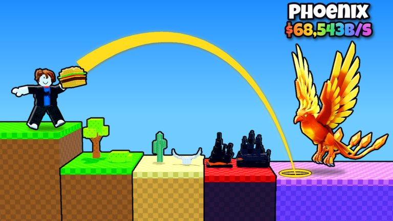
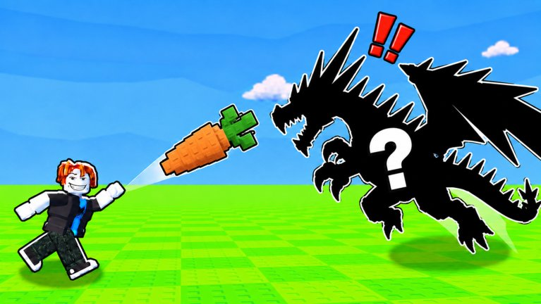
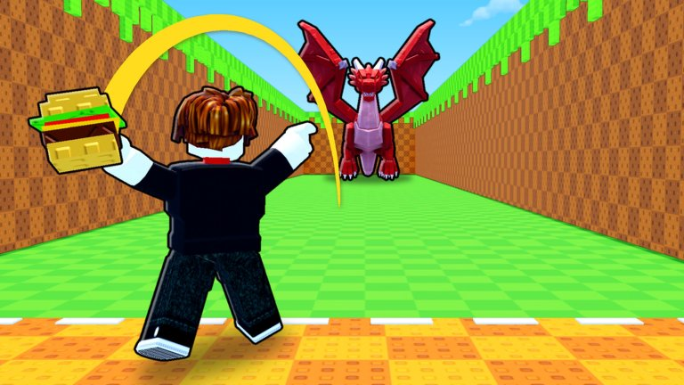
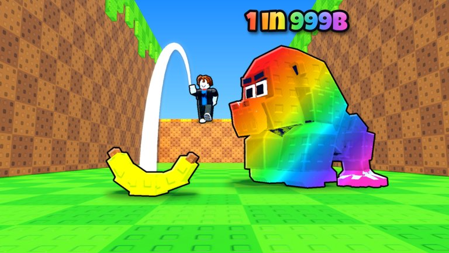

**Throw Food For Animals**는 먹이를 멀리 던져서 동물을 꼬시고, 그 동물을 내 땅에 둬서 돈 버는 로블록스 게임이야. 9월 18일에 나온 신작인데, 11월 7일 집계 기준 동시접속 약 35만 명으로 로블록스 전체 4위까지 올라왔어.

*이미지: 로블록스 'Throw Food For Animals' 공식 썸네일*

규칙은 단순한데, 처음엔 뭘 먼저 올려야 할지 헷갈려. 이 순서대로 하면 금방 감 와.

## 무슨 게임인데?

게임은 이 순서로 계속 돌아가.

1. **던지기**: 먹이를 앞쪽 길로 던져. 먹이가 떨어진 자리로 동물이 와.
2. **모으기**: 먹이 먹으러 온 동물이 내 거가 돼.
3. **배치**: 잡은 동물을 내 땅(플롯)에 올려두면 1초마다 돈이 들어와.
4. **업그레이드**: 번 돈으로 더 좋은 먹이 사고, 철봉 운동으로 던지는 힘을 키워.
5. **새 구역**: 멀리 던질수록 더 센 구역에 닿고, 거기선 훨씬 비싼 동물이 나와.

한 서버에 최대 5명까지 들어가. 남이랑 싸우는 게임이 아니라서 혼자 해도 편해.

## 처음엔 당근부터

*이미지: 로블록스 'Throw Food For Animals' 공식 썸네일*

시작하면 공짜 **당근**을 줘. 처음엔 개구리나 토끼 같은 흔한 동물이 나오는데, 이걸로 돈 모으는 게 시작이야.

- 먹이는 내 땅 입구 쪽 **먹이 가게**에서 사.
- 먹이를 사고 나서 **장착**(EQUIP)을 따로 눌러야 바뀌어. 사놓고 계속 당근 던지는 실수 많이 함.
- 다음 먹이로 갈수록 가격이 몇 배씩 뛰어. 싼 걸 하나씩 다 사지 말고, 돈 모아서 한 단계 좋은 걸 노려.

## 제일 중요한 건 던지는 힘

*이미지: 로블록스 'Throw Food For Animals' 공식 썸네일*

이 게임은 **얼마나 멀리 던지냐가 곧 실력**이야. 먹이가 비싸도 거리가 안 나오면 앞쪽에서 떨어져서 약한 동물만 와.

- **철봉**: 튜토리얼 끝나면 철봉이 열려. 턱걸이 한 번 할 때마다 경험치가 쌓이고, 레벨이 오르면 던지는 힘(Throw Power)이 올라. 운동 자체는 공짜야.
- **철봉 업그레이드**: 돈은 철봉 바꾸는 데만 들어. 좋은 철봉일수록 한 번에 얻는 경험치가 커져. 첫 업그레이드는 싸니까 다음 먹이보다 먼저 사는 게 이득이야.
- **타이밍**: 던질 때 게이지가 움직이는데, 끝 쪽에서 딱 멈추면 더 멀리 날아가. 처음 몇 번은 연습 삼아 던져봐.

던지는 힘이 부족하면 새 구역에 아예 못 닿아. 먹이를 바꿔도 동물이 그대로면 철봉부터 올려.

## 행운은 멀리 던질수록 올라가

*이미지: 로블록스 'Throw Food For Animals' 공식 썸네일*

희귀한 동물이 나올 확률은 **먹이가 날아간 거리**에 따라 정해져. 각 구역의 길을 앞·중간·뒤로 나누면, 제일 희귀한 동물은 **맨 뒤쪽**에 떨어졌을 때만 나와.

- 좋은 먹이일수록 날아가는 동안 행운이 더 많이 붙어.
- 던지는 중에 화면에 행운 수치가 떠. 이걸 보면 지금 거리가 충분한지 알 수 있어.
- 결과 카드에 **NEW!**가 뜨면 처음 잡은 동물이고, **LUCKY!**나 **SUPER LUCKY!**가 뜨면 특별한 변종이 나온 거야.

## 동물은 '초당 수익' 보고 배치해

- 잡기만 하고 가방에 두면 **돈을 한 푼도 안 벌어.** 꼭 내 땅에 올려.
- 땅에 둘 수 있는 자리가 정해져 있어서, 좋은 동물을 잡으면 약한 애랑 바꿔.
- 동물 메뉴의 **베스트 장착**(Equip Best)을 누르면 제일 많이 버는 애들로 알아서 채워줘.
- 이름이 같아도 **황금 변종이나 크기**에 따라 버는 돈이 달라. 팔기 전에 수익부터 확인해.
- 땅에 둔 동물은 게임을 꺼도 계속 돈을 벌어.
- 왼쪽의 **도감**(Index)에서 한 구역 동물을 다 모으면 보너스 돈을 줘.

## 추천 순서 한눈에

1. 당근으로 동물 몇 마리 잡아서 땅 채우기
2. 첫 철봉 업그레이드
3. 철봉 운동으로 던지는 힘 올리기
4. 돈 모아서 한 단계 좋은 먹이 사고 장착
5. 땅 넓히고 베스트 장착
6. 거리 충분해지면 다음 구역 노리기

## 초보가 자주 하는 실수

- **먹이만 계속 바꾸기**: 거리가 안 나오면 비싼 먹이도 앞쪽에 떨어져. 동물이 안 바뀌면 먹이 말고 철봉 문제야.
- **동물 가방에 쌓아두기**: 땅에 안 올리면 수익 0이야. 잡을 때마다 베스트 장착 한 번씩 눌러.
- **흔한 동물 바로 팔기**: 변종이나 큰 크기면 같은 이름이어도 훨씬 많이 벌 수 있어. 수익 확인하고 팔아.
- **철봉 운동 안 하기**: 운동은 공짜야. 돈 모으는 동안 틈틈이 해두면 다음 구역이 빨리 열려.

## 로벅스 쓰기 전에 알아둘 것

게임 안에 로벅스로 사는 것들이 있어. 가격은 바뀔 수 있으니까 참고만 해.

| 상품 | 효과 |
|---|---|
| 서버 행운 부스트 | 15분 동안 서버 전체 행운 2~16배 |
| x2 Cash 게임패스 | 모든 동물 수익 2배 |
| x2 Training Power 게임패스 | 철봉 경험치 2배 |

행운 부스트는 15분 지나면 끝나는 소모품이야. 없어도 충분히 할 수 있는 게임이니까, 살 거면 부모님이랑 먼저 얘기해. 가끔 개발자가 여는 **어드민 이벤트** 때는 서버 행운이 공짜로 올라가니까 그때를 노리는 것도 방법이야.

## 이건 진짜 조심해

- 게임은 로블록스 앱 안에서 직접 검색해서 들어가. 이상한 외부 링크로 들어가지 마.
- "무료 로벅스", "희귀 동물 공짜로 줄게" 이런 건 거의 다 계정 털려는 사기야. 비밀번호는 누가 물어봐도 절대 알려주지 마.

## 참고한 곳
- [Throw Food For Animals - Roblox 게임 페이지](https://www.roblox.com/games/120219252362013)
- [Throw Food For Animals Beginners Guide - Bloxodes](https://bloxodes.com/articles/throw-food-for-animals-beginners-guide)
- [Throw Food For Animals Luck Guide - Bloxodes](https://bloxodes.com/articles/throw-food-for-animals-luck-guide)
- [Throw Food For Animals Wiki - Bloxodes](https://bloxodes.com/wiki/throw-food-for-animals)
- [Throw Food For Animals Animals - game.guide](https://www.game.guide/throw-food-for-animals/animals)
- [Roblox Top Playing Now 차트 - Endgame Tools](https://endgametools.com/en/roblox/charts)
