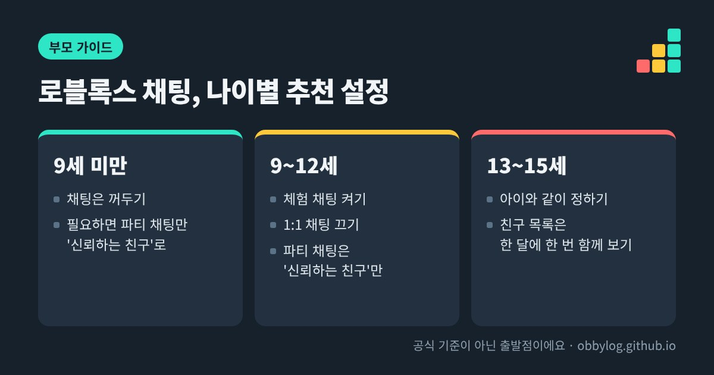

로블록스 채팅은 이제 **연령 확인을 마친 사용자만** 쓸 수 있고, 비슷한 나이대끼리만 대화하도록 묶여 있어요. 부모님은 자녀 보호 설정에서 채팅을 종류별로 끄거나 '신뢰하는 친구'로만 좁힐 수 있어요. 다만 설정만으로 막기 어려운 게 사기예요. 아이들이 당하는 사기는 대부분 **공식 기능 밖에서 거래하거나, 로그인 정보를 넘기는 순간** 시작돼요.

*이미지: 옵비로그*

## 요즘 로블록스 채팅은 이렇게 달라졌어요

로블록스는 2026년 1월부터 채팅이 가능한 모든 지역에서 채팅 전에 연령 확인을 하도록 바꿨어요. 얼굴 사진으로 나이를 추정하는 방식이 기본이고, 결과가 틀렸다면 신분증 확인이나 부모님의 자녀 보호 설정으로 나이를 고칠 수 있어요. 로블록스는 나이 추정에 쓴 사진과 영상을 처리 직후 지운다고 안내하고 있어요.

연령 확인이 끝나면 아래처럼 나이대가 나뉘어요.

| 연령대 | 기본으로 대화할 수 있는 상대 |
|---|---|
| 9세 미만 | 부모 동의가 있어야 채팅 가능. 허용해도 13세 미만이나 신뢰하는 친구와만 대화 |
| 9~12세 | 자기 나이대와 바로 위·아래 나이대 |
| 13~15세 | 자기 나이대와 바로 위·아래 나이대 |
| 16세 미만 공통 | 성인과는 대화가 제한돼요 |

예전처럼 아무나 말을 거는 구조는 아니라는 뜻이에요. 그래도 아이가 나이를 다르게 확인받았거나, 친구 목록에 모르는 사람이 들어와 있으면 이 울타리가 약해져요.

## 채팅 종류별로 막을 수 있는 것

로블록스 채팅은 한 가지가 아니에요. 종류마다 따로 설정해요.

| 채팅 종류 | 어떤 대화인가요 | 부모 설정 |
|---|---|---|
| 체험 채팅 | 게임 안에서 같은 서버 사람들이 다 보는 채팅 | 켜기 / 끄기 |
| 1:1 채팅 | 게임 안에서 한 사람과만 주고받는 메시지 | 켜기 / 끄기 |
| 파티 채팅 | 친구끼리 주고받는 메시지 (9세 이상) | 모든 친구 / 신뢰하는 친구 / 아무도 없음 |
| 파티 음성 | 파티 안 음성 대화 (13세 이상) | 신뢰하는 친구 / 아무도 없음 |

경로는 **설정 → 자녀 보호 → 자녀 계정 선택 → 커뮤니케이션**이에요. 한 가지 주의할 점은, 게임 제작자가 직접 만든 채팅 기능에는 체험 채팅·1:1 채팅 설정이 적용되지 않는다는 거예요. 아이가 자주 하는 게임에 별도 채팅창이 있는지 한 번 같이 확인해보세요.

## 아이 나이에 맞춘 추천 설정

공식 기준은 아니고, 위 기능을 바탕으로 정리한 출발점이에요. 아이 성향에 맞게 조정하세요.

- **9세 미만**: 채팅은 꺼두는 걸 권해요. 친구와 함께 놀고 싶어 하면 파티 채팅만 '신뢰하는 친구'로 열어주세요.
- **9~12세**: 체험 채팅은 켜두되 1:1 채팅은 끄고, 파티 채팅은 '신뢰하는 친구'로 두세요. 13세 미만이 신뢰하는 친구를 추가하면 부모님께 승인 요청이 가고, 24시간 안에 승인해야 해요.
- **13~15세**: 직접 막기보다 아이와 같이 설정을 정하는 쪽을 로블록스도 권하고 있어요. 다만 일부 기능은 15세까지 부모님이 관리할 수 있어요.

## 친구 목록은 한 달에 한 번 같이 보세요

부모님은 자녀의 친구(연결) 목록을 아바타와 이름으로 볼 수 있어요. 모르는 이름이 있으면 아이에게 "이 친구는 어떻게 알게 됐어?" 하고 가볍게 물어보세요. 학교 친구인지, 게임에서 처음 만난 사람인지만 알아도 충분해요.

목록에서 바로 **차단**하거나 **신고**할 수 있고, 차단된 사용자는 부모님 허락 없이 다시 연결되거나 직접 채팅할 수 없어요. 비공개 서버도 '연결된 친구만' 또는 '아무도 없음'으로 참여를 제한할 수 있어요.

## 아이들이 실제로 당하는 사기 수법

보안 업체와 로블록스 고객센터 안내를 보면, 사기는 거의 같은 패턴으로 반복돼요.

1. **무료 로벅스 사이트**: 로블록스처럼 꾸민 페이지에서 아이디와 비밀번호를 넣으면 로벅스를 준다고 해요. 입력하는 순간 계정을 넘겨주는 거예요.
2. **게임 안 가짜 로그인 창**: 무료 로벅스를 준다는 게임 안에서 로그인 화면을 띄워요. 진짜 로블록스 로그인 화면이 아니에요.
3. **"이거 복사해서 주소창에 붙여넣어"**: 아바타를 꾸며준다거나 아이템을 준다며 코드를 붙여넣게 하거나, 즐겨찾기를 추가하게 해요. 이렇게 하면 로그인 상태가 통째로 넘어가요. 개발자 도구를 열어 파일을 보내달라는 요청도 같은 수법이에요.
4. **말이 안 되게 좋은 거래**: 아이템을 '확인'해야 한다며 다른 화면에서 번호를 입력하게 하거나, 거래 두 개를 묶어서 하자고 해요. 결국 아이 아이템만 넘어가요.
5. **"네가 먼저 주면 나도 줄게"**: 공식 거래 기능을 쓰지 않는 약속이에요.

로블록스는 공식 거래 기능이나 판매 기능 밖에서 한 약속은 보호하지 못하고, 아이템이나 로벅스를 돌려줄 수도 없다고 안내해요. 그래서 아이에게는 "공식 거래 버튼 말고 다른 방법을 말하면 무조건 사기"라고 단순하게 알려주는 게 효과가 좋아요.

## 이미 당했다면

- 비밀번호를 바로 바꾸세요. 같은 비밀번호를 다른 곳에서도 썼다면 그곳도 함께 바꾸세요.
- 계정 보안 설정에서 **2단계 인증**을 켜두세요.
- 사기를 친 사용자는 **신고**(Report Abuse) 버튼으로 신고하세요. 다른 아이들이 같은 일을 당하는 걸 막을 수 있어요.
- 아이를 혼내기보다 "말해줘서 고마워"가 먼저예요. 혼나면 다음에는 숨기게 돼요.

## 설정보다 오래 가는 한 가지

어떤 설정도 아이가 "이상한 일이 생기면 엄마 아빠한테 말한다"는 습관을 대신하지는 못해요. 아이가 좋아하는 게임을 한 판 같이 해보고, 그 게임에서 누가 말을 걸면 어떻게 할지 이야기해보세요. 비밀번호는 친구에게도, 운영자라고 하는 사람에게도 알려주지 않는다는 것 하나만 확실히 해둬도 대부분의 사기는 막을 수 있어요.

## 참고한 곳
- [자녀 보호 기능 안내 - 로블록스 공식 (한국어)](https://about.roblox.com/ko/parental-controls)
- [Roblox Requires Age Checks to Chat - 로블록스 뉴스룸 (2026년 1월)](https://about.roblox.com/newsroom/2026/01/roblox-age-checks-required-to-chat)
- [Trading and scams - 로블록스 고객센터](https://en.help.roblox.com/hc/articles/203312390)
- [Roblox scam overview - Cisco Talos](https://blog.talosintelligence.com/roblox-scam-overview/)
