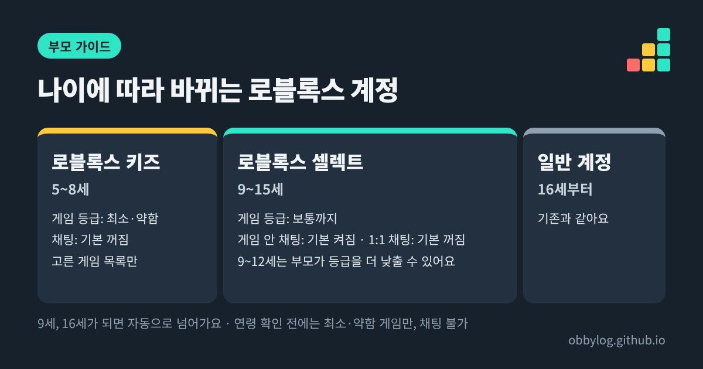

올해 6월부터 로블록스는 16세 미만 계정을 나이에 따라 자동으로 나눠요. **5~8세는 '로블록스 키즈', 9~15세는 '로블록스 셀렉트'** 계정이 되고, 계정마다 할 수 있는 게임 등급과 채팅 기본값이 달라요. 아이 화면 색이 바뀌었거나 하던 게임이 갑자기 안 보인다면 대부분 이 변화 때문이에요. 부모님은 자녀 보호 설정에서 아이 나이가 맞게 들어가 있는지부터 확인하시면 돼요.

*이미지: 옵비로그*

## 무엇이 바뀌었나요

로블록스는 4월에 이 계정들을 발표했고, 6월 중순부터 전 세계에 적용했어요. 핵심은 세 가지예요.

- **나이에 맞는 게임만 보여요.** 키즈와 셀렉트 계정은 로블록스가 따로 고른 게임 목록 안에서만 놀 수 있어요. 이 목록은 계속 바뀌어요.
- **계정마다 화면 디자인이 달라요.** 키즈 계정은 계정 전체에 고유한 배경색이 들어가서, 부모님이 한눈에 알아볼 수 있게 했어요.
- **나이가 차면 자동으로 넘어가요.** 9세가 되면 키즈에서 셀렉트로, 16세가 되면 셀렉트에서 일반 계정으로 바뀌어요. 16세 이상은 달라지는 게 없어요.

| | 로블록스 키즈 | 로블록스 셀렉트 |
|---|---|---|
| 나이 | 5~8세 | 9~15세 |
| 할 수 있는 게임 등급 | 최소·약함 | 보통까지 |
| 게임 안 채팅 | 기본 꺼짐 (부모님이 켤 수 있음) | 기본 켜짐 |
| 1:1 채팅 | 부모님이 켜야 가능 | 기본 꺼짐 (부모님이 켤 수 있음) |
| 등급 조정 | 부모님이 관리 | 9~12세는 부모님이 더 낮출 수 있음 |

나이와 기능은 나라에 따라 조금 다를 수 있다고 로블록스가 밝히고 있어요. 위 표는 로블록스 한국어 안내의 "대부분 지역" 기준이에요.

## 하던 게임이 안 보여요

부모님들이 가장 많이 겪는 상황이에요. 이유는 크게 세 가지예요.

**1. 게임 등급이 계정보다 높아요.** 셀렉트 계정은 '보통' 등급까지만 열려 있어서, 그보다 높은 등급의 게임은 목록에서 빠져요.

**2. 키즈·셀렉트에서 기본으로 빠지는 종류예요.** 로블록스는 민감한 주제를 다루는 게임, 낯선 사람과 어울리는 데 초점을 둔 소셜 모임형 게임, 자유롭게 그림을 그리는 게임은 기본 목록에서 빼고 있어요.

**3. 아이가 아직 연령 확인을 안 했어요.** 연령 확인을 마치지 않은 사용자는 '최소·약함' 등급 게임만 할 수 있고, 채팅도 쓸 수 없어요. 원래 나이를 높게 적어뒀더라도 마찬가지예요.

게임을 만드는 쪽에도 조건이 생겼어요. 키즈·셀렉트 목록에 들어가려면 개발자가 신원 인증과 2단계 인증을 마쳐야 하고, 유료 구독(로블록스 플러스)도 유지해야 해요. 그래서 작은 개인 제작 게임 중에는 내용과 상관없이 목록에 없는 경우도 있어요.

## 부모님이 확인할 순서

1. **부모 계정과 연결되어 있나요?** 자녀 보호 대시보드는 부모 계정을 아이 계정과 연결해야 쓸 수 있어요. 아직이라면 [결제 한도 설정 글](/parent/roblox-spending-limit-parent-guide/)에 연결 순서를 정리해뒀어요.
2. **아이 나이가 맞게 들어가 있나요?** 나이가 잘못 들어가면 계정 종류도 잘못 정해져요. 연령 확인 결과가 틀렸다면 자녀 보호 설정에서 고칠 수 있어요.
3. **게임 등급은 괜찮은가요?** 9~12세라면 셀렉트 기본값(보통)보다 낮게 조정할 수 있어요.
4. **채팅 설정을 다시 봤나요?** 계정 종류에 따라 기본값이 달라졌어요. 나이별로 어떻게 두면 좋을지는 [로블록스 채팅 나이별 설정 가이드](/parent/roblox-chat-settings-scam-guide/)를 참고하세요.
5. **이용 시간과 결제 한도도 같이 봤나요?** 같은 대시보드에서 화면 사용 시간과 월 지출 한도를 함께 정할 수 있어요.

## 특정 게임만 허용하거나 막고 싶을 때

계정 종류가 정한 범위가 우리 집 기준과 다를 수 있어요. 그럴 때는 게임 하나 단위로 조정할 수 있어요.

- **막기**: 계정 기준으로는 허용되지만 우리 아이에게는 맞지 않다고 생각하는 게임을 차단할 수 있어요. 이 기능은 아이가 15세가 될 때까지 쓸 수 있어요.
- **따로 허용하기**: 반대로 기본 계정에서는 막혀 있지만 부모님이 괜찮다고 판단한 게임은 개별로 승인할 수 있어요.

허용하기 전에 아이와 같이 그 게임을 한 판 해보시는 걸 권해요. 등급 표시만으로는 채팅 분위기나 아이템 거래가 얼마나 많은지까지는 알기 어렵거든요.

## 아직 정해지지 않은 것

로블록스는 올해 안에 국제 연령 등급 체계(IARC)로 옮겨가겠다고 발표했어요. 전환이 시작되면 게임 등급 이름이나 기준이 바뀔 수 있어요. 지금 시점에 한국 계정에 언제 어떻게 적용되는지는 공식 안내에서 확인하지 못했어요. 바뀌는 내용이 나오면 이 글을 업데이트할게요.

## 아이에게 이렇게 설명해보세요

화면이 바뀐 걸 아이가 "벌 받는 것"처럼 느끼지 않게, 나이에 맞춰 안전한 게임을 골라주는 장치라고 설명해주세요. 하고 싶은 게임이 막혀 있으면 몰래 다른 계정을 만들기보다 먼저 말해달라고 약속하고, 부모님이 같이 보고 허용 여부를 정하면 아이도 납득하기 쉬워요.

## 참고한 곳
- [Roblox Kids 및 Roblox Select 계정 소개 - 로블록스 뉴스룸 (한국어)](https://about.roblox.com/ko/newsroom/2026/04/introducing-roblox-kids-and-select-accounts)
- [연령별 안전 - 로블록스 공식 (한국어)](https://about.roblox.com/ko/safety-by-age)
- [자녀 보호 기능 안내 - 로블록스 공식 (한국어)](https://about.roblox.com/ko/parental-controls)
- [Roblox Kids & Select global rollout - Bloxodes](https://bloxodes.com/articles/roblox-kids-select-accounts-global-rollout)
- [Providing Appropriate Content: Roblox Introduces Age-Based Accounts - 게임메카](https://www.gamemeca.com/en/view.php?gid=1774000)
