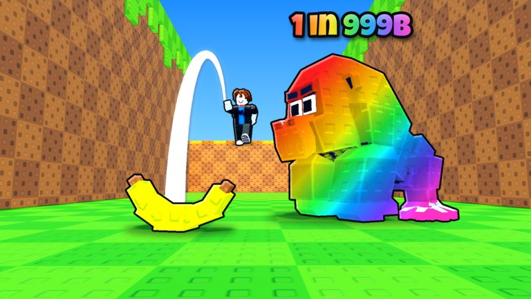

**Throw Food For Animals**에서 동물을 잡으면 **변이**(Mutation) 한 번, **크기**(Size) 한 번을 따로 굴려. 변이는 골드(1.5배)부터 무지개(20배)까지 5종, 크기는 빅(1.5배)부터 인피니트(38배 이상)까지 9종이고, **두 배수는 곱해져.** 그래서 무지개 인피니트가 최고 조합이고, 이름만 희귀한 동물보다 **곱한 값이 큰 동물**을 땅에 올리는 게 돈을 제일 많이 벌어.

*이미지: 로블록스 'Throw Food For Animals' 공식 썸네일*

[초보 공략](/game/throw-food-for-animals-beginner-guide/)에서 결과 카드에 LUCKY! 같은 표시가 뜬다는 얘기를 했는데, 그게 바로 이 변이랑 크기야. 이번엔 이것만 깊게 파볼게.

## 변이 5종, 확률이랑 배수

보통 던지기 기준이야. 공략 사이트 세 곳의 숫자가 같았어.

| 변이 | 확률 | 수익 배수 |
|---|---|---|
| 골드 (Gold) | 13% | 1.5배 |
| 다이아몬드 (Diamond) | 4% | 3배 |
| 에메랄드 (Emerald) | 2% | 5배 |
| 루비 (Ruby) | 1% | 10배 |
| 무지개 (Rainbow) | 0.5% | 20배 |

변이가 붙으면 겉모습부터 달라져. 골드는 반짝이는 금색, 다이아몬드는 수정 같은 몸, 에메랄드는 초록색, 루비는 붉은색, 무지개는 여러 색이 섞여 보여서 땅에 올려두면 바로 티가 나.

다 더하면 20.5%야. 거꾸로 말하면 **열 번 중 여덟 번은 변이 없이** 나온다는 뜻이야. 변이는 보너스라고 생각하고, 안 나왔다고 실망할 필요 없어. 동물 하나에 변이는 하나만 붙어.

무지개는 0.5%라서 평균으로 치면 200번 던져야 한 번 나오는 확률이야.

## 크기 9종, 한 단계마다 1.5배

크기는 한 단계 올라갈 때마다 1.5배씩 곱해지는 구조야.

| 크기 | 확률 | 수익 배수 |
|---|---|---|
| 빅 (Big) | 15% | 1.5배 |
| 라지 (Large) | 3.5% | 2.25배 |
| 휴지 (Huge) | 0.97% | 3.38배 |
| 콜로설 (Colossal) | 0.31% | 5.06배 |
| 기간틱 (Gigantic) | 0.12% | 7.59배 |
| 타이타닉 (Titanic) | 0.05% | 11.39배 |
| 몬스트러스 (Monstrous) | 0.02% | 17.09배 |
| 코스믹 (Cosmic) | 0.008% | 25.63배 |
| 인피니트 (Infinite) | 0.005% | 38배 이상 |

인피니트는 0.005%라서 평균 2만 번에 한 번이야. 공략에서도 배수를 "38배 이상"이라고만 적어둬서 정확한 최댓값은 아직 확실하지 않아.

## 핵심: 희귀한 것보다 곱한 값

변이랑 크기는 따로 굴리고 **곱해져.** 그래서 이름만 보고 고르면 손해 보는 경우가 생겨.

- 변이 없는 **기간틱**(7.59배) > **다이아몬드 빅**(3 × 1.5 = 4.5배)
- 변이 없는 **인피니트**(38배) > **무지개 빅**(20 × 1.5 = 30배)
- **골드 휴지**(1.5 × 3.38 = 약 5.1배) > 그냥 **에메랄드**(5배)

무지개가 떴다고 무조건 좋은 게 아니라, 크기까지 같이 보고 곱한 값으로 비교해야 해. 동물을 바꾸거나 팔기 전에 동물 정보에서 초당 수익을 한 번 확인하는 습관을 들이면 실수가 확 줄어.

참고로 최고 조합인 무지개 인피니트는 20 × 38 = **760배**야. 확률은 0.5%와 0.005%를 곱해야 해서, 보통 던지기로는 평균 400만 번에 한 번꼴이야. 사실상 노리고 하는 조합은 아니니까 너무 신경 쓰지 마.

## 확률을 올리는 방법

- **던지는 힘 키우기**: 철봉 운동으로 던지는 힘을 올리면 먹이가 더 멀리 날아가고, 날아가는 동안 행운이 더 쌓여. 공짜로 할 수 있는 제일 확실한 방법이야.
- **좋은 먹이 쓰기**: 상위 먹이일수록 행운이 더 붙어.
- **던지기 전에 확률 보기**: 맵에서 던질 준비를 하면 상세 정보(Details)에서 지금 내 상태의 실제 확률을 볼 수 있어. 먹이나 힘을 바꿀 때마다 다시 확인해봐.
- **어드민 이벤트 노리기**: 개발자가 가끔 여는 어드민 이벤트 때는 큰 크기가 나올 확률이 눈에 띄게 오른다고 해.

**럭키 던지기**(Lucky Throw)라는 로벅스 아이템도 있어. 이걸 쓰면 희귀 변이 확률이 확 올라가. 공략들에 따르면 무지개가 0.5%에서 14%까지 오른다고 해. 다만 가격은 확인하지 못했어. 공짜로 확률을 올리는 방법이 위에 다 있으니까 굳이 안 사도 돼. 쓰고 싶으면 부모님이랑 먼저 얘기해.

## 뭘 남기고 뭘 팔까

1. 변이 종류별, 크기별로 **제일 배수가 높은 동물 하나씩**은 남겨둬.
2. 땅 자리가 모자라면 **곱한 배수가 낮은 순서**로 바꿔.
3. 같은 이름, 같은 변이, 같은 크기가 겹치면 팔아도 돼.

희귀한 무지개 동물을 "공짜로 줄게"라며 계정 정보를 묻는 건 이 게임에서도 사기야. 동물은 내가 직접 잡는 것 말고는 받을 방법이 없다고 생각하면 돼.

## 참고한 곳
- [Throw Food For Animals Mutations and Sizes - Of Zen and Computing](https://www.ofzenandcomputing.com/throw-food-for-animals-mutations-and-sizes/)
- [Throw Food For Animals Mutations and Sizes Guide - Roonby](https://roonby.com/2026/11/06/throw-food-for-animals-mutations-and-sizes-guide-all-multipliers-explained/amp/)
- [Throw Food For Animals Mutations Guide - Bloxodes](https://bloxodes.com/articles/throw-food-for-animals-mutations-guide)
- [Throw Food For Animals - Roblox 게임 페이지](https://www.roblox.com/games/120219252362013)
