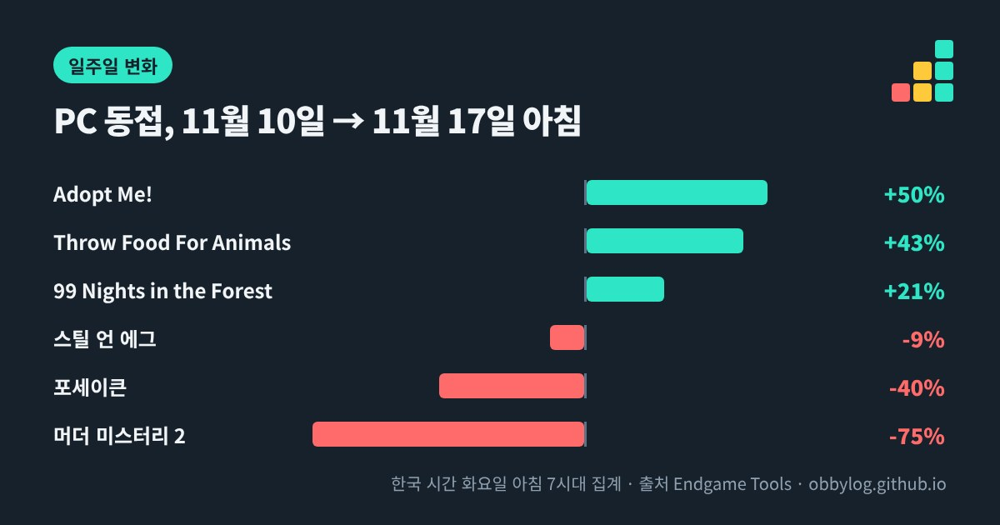

이번 주 로블록스 순위에서 제일 큰 변화는 **머더 미스터리 2의 급락**이야. 지난주 48만 8천 명으로 2위였는데, 할로윈 이벤트가 끝난 직후인 이번 주엔 12만 1천 명, 6위로 내려왔어. 반대로 **Adopt Me!**는 50%, **Throw Food For Animals**는 43% 늘어서 각각 3위, 5위로 올라왔어. 1위는 이번 주도 **스틸 언 에그**야.

*이미지: 옵비로그*

## 어떻게 비교했어?

숫자는 Endgame Tools에서 PC 동접 기준으로 가져왔어. 지난주 [11월 10일 순위 글](/game/roblox-top-games-2026-11-10/)과 이번 주 둘 다 **한국 시간 화요일 아침 7시대**, 미국 기준으로는 월요일 오후에 찍힌 숫자야. 요일이랑 시간이 같아서 주말 효과 같은 게 섞이지 않고, 딱 일주일 동안 생긴 변화만 볼 수 있어.

## 이번 주 눈에 띄는 것 세 가지

**1. 이벤트가 끝나면 사람이 빠진다**

머더 미스터리 2는 할로윈 이벤트 마감(한국 시간 11월 17일 새벽 3시) 직전에 사람이 몰렸다가, 마감 4시간 뒤 집계에서 75%가 빠졌어. [MM2 이벤트 정리 글](/update/mm2-halloween-2026-deadline/)에서 마감 전에 몰린다고 했던 게 숫자로 그대로 나온 셈이야. 이벤트 때 오른 순위는 이벤트가 끝나면 원래 자리로 돌아가는 경우가 많으니까, 순위 볼 때 이벤트 기간인지 같이 봐야 해.

**2. Adopt Me!와 Throw Food For Animals가 크게 올랐다**

Adopt Me!는 15만 2천 명에서 22만 8천 명, Throw Food For Animals는 14만 5천 명에서 20만 8천 명이 됐어. 둘 다 블록스 프루츠를 거의 따라잡았어. 왜 늘었는지는 아직 확인 못 했어. 업데이트나 이벤트 소식이 나오면 따로 정리할게. Throw Food For Animals가 궁금하면 [초보 공략](/game/throw-food-for-animals-beginner-guide/)이랑 [변이·크기 정리](/game/throw-food-for-animals-mutations-sizes/)부터 보면 돼.

**3. 포세이큰은 8위에서 16위로**

공포 게임 포세이큰은 9만 5천 명에서 5만 7천 명으로 40% 줄어서 8계단 내려갔어. 대신 99 Nights in the Forest는 21% 늘어서 10위에서 8위로 올라왔어.

## TOP 20 전체 (지난주 대비)

| 순위 | 게임 | 동접 | 지난주 순위 |
|---|---|---|---|
| 1 | 스틸 언 에그 | 513,764 | 1 |
| 2 | 브룩헤이븐 | 334,319 | 3 ▲ |
| 3 | 입양하세요! (Adopt Me!) | 228,136 | 5 ▲ |
| 4 | 블록스 프루츠 | 208,667 | 4 |
| 5 | Throw Food For Animals | 207,978 | 6 ▲ |
| 6 | 머더 미스터리 2 | 120,876 | 2 ▼ |
| 7 | 라이벌스 | 108,040 | 7 |
| 8 | 99 Nights in the Forest | 105,401 | 10 ▲ |
| 9 | 주술 셰나니건스 | 79,670 | 11 ▲ |
| 10 | 댄디스 월드 | 69,471 | 9 ▼ |
| 11 | 브레이크 앤 스틸 언 에그 | 65,637 | 12 ▲ |
| 12 | 애니메 어드벤처스 | 65,474 | 13 ▲ |
| 13 | 피시 잇 (Fish It!) | 62,135 | 15 ▲ |
| 14 | 머더러 vs 셰리프 | 61,506 | 14 |
| 15 | 카탈로그 아바타 크리에이터 | 60,557 | 17 ▲ |
| 16 | 포세이큰 | 56,913 | 8 ▼ |
| 17 | 래그돌 사커 (Ragdoll Soccer) | 56,883 | 새로 진입 |
| 18 | 피쉬 (Fisch) | 49,798 | 20 ▲ |
| 19 | 드레스 투 임프레스 (Dress To Impress) | 49,689 | 새로 진입 |
| 20 | 펫 시뮬레이터 99 | 44,392 | 새로 진입 |

## 새로 들어오고 빠진 게임

- **새로 들어옴**: 래그돌 사커, 드레스 투 임프레스, 펫 시뮬레이터 99
- **빠짐**: 스틸 어 브레인롯(지난주 16위), 베리 애비뉴(18위), 돈 스플래시(19위)

스틸 어 브레인롯이 20위 밖으로 밀려난 건 좀 의외야. [브레인롯 글](/meme/brainrot-meaning/)에서 말했던 그 역대 동접 기록 게임이거든. 유행이 확실히 다른 게임들로 옮겨가는 중인 것 같아.

## 다음 주에 볼 것

- 이번 주 [피시 잇](/game/fish-it-beginner-guide/)이 13위까지 올라왔어. 낚시 게임 두 개(피시 잇, 피쉬)가 둘 다 오른 게 이어질지 볼 만해.
- "떠오르는 게임" 목록 맨 위는 이번 주 리얼리스틱 래그돌 MMA(Realistic Ragdoll MMA)였어. 래그돌 사커까지 20위 안에 들어온 걸 보면, 캐릭터가 흐물흐물하게 넘어지는 래그돌 물리 게임이 요즘 뜨는 흐름이야.

## 참고한 곳
- [Roblox Charts - Endgame Tools](https://endgametools.com/en/roblox/charts) (11월 9일 22:56 UTC, 11월 16일 22:23 UTC 집계)
