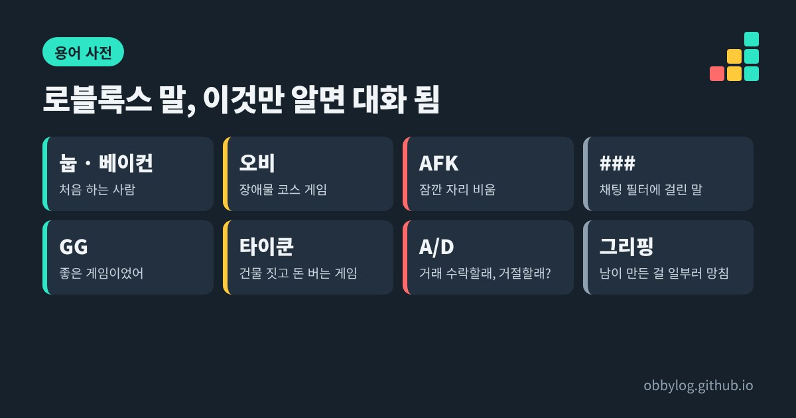

로블록스 채팅에서 제일 자주 보이는 말 몇 개만 먼저 풀면, **눕**(noob)이랑 **베이컨**은 "처음 하는 사람", **오비**(obby)는 "장애물 코스 게임", **AFK**는 "잠깐 자리 비움", **GG**는 "좋은 게임이었어"야. 아래에 다섯 갈래로 나눠서 더 정리해뒀으니까, 모르는 말이 나오면 찾아보는 용도로 써.

*이미지: 옵비로그*

## 1. 처음 들으면 헷갈리는 말

- **눕**(noob): 처음 하는 사람, 아직 서툰 사람. 친구끼리 장난으로도 쓰지만 상대를 깔볼 때도 써서 듣는 사람 기분 따라 달라.
  > "나 이 게임 오늘 처음이라 완전 눕임"
- **베이컨**(bacon): 이것도 초보라는 뜻이야. 새 계정을 만들면 기본으로 주는 갈색 머리가 베이컨 조각처럼 생겨서 붙은 별명이야. 아이템이 없는 사람을 놀릴 때도 쓰여서, 남한테 쓸 때는 조심해.
- **로블록시안**(Robloxian): 로블록스 하는 사람 전부를 부르는 말.
- **데브**(devs): 게임을 만든 개발자. "데브가 업데이트 언제 하냐" 하면 그 게임 만든 사람 얘기야.
- **텀드**(termed): 계정이 영구 정지됐다는 뜻. 규칙을 크게 어기면 이렇게 될 수 있어.
- **우프**(oof): 캐릭터가 죽을 때 나던 "우프" 소리에서 나온 말이야. 아플 때 "아야"처럼 써. 이 소리는 원래 다른 회사 게임에서 가져온 거라 저작권 문제로 2022년 7월에 사라졌다가, 2025년 7월에 다시 돌아왔어.

## 2. 게임 장르 이름

게임 제목이나 검색어에 자주 붙는 말이야. 이것만 알아도 무슨 게임인지 대충 감이 와.

| 말 | 무슨 게임인데? |
|---|---|
| 오비 (Obby) | 점프하고 피하면서 끝까지 가는 장애물 코스 |
| 타이쿤 (Tycoon) | 건물이나 가게를 키우면서 돈을 버는 게임 |
| 시뮬레이터 (Simulator) | 낚시, 요리, 채굴 같은 걸 흉내 내면서 키우는 게임 |
| RP (롤플레이) | 학교나 마을에서 역할을 정해 연기하며 노는 게임. 브룩헤이븐이 대표적이야 |
| 브릭배틀 (Brickbattle) | 무기를 들고 싸우는 전투 게임 |
| FFA | 팀 없이 각자 싸우는 개인전 |

[피시 잇](/game/fish-it-beginner-guide/)처럼 뭔가를 모아서 팔고 업그레이드하는 게임은 시뮬레이터랑 타이쿤 느낌이 섞여 있어.

## 3. 채팅 줄임말

- **AFK**: 잠깐 자리 비움. "AFK 5분"이면 5분 뒤에 온다는 뜻.
- **BRB**: 곧 돌아올게.
- **GG**: 좋은 게임이었어. 이기든 지든 끝나고 하는 인사야.
- **렉**(lag): 인터넷이 느려서 화면이 끊기는 거.
- **그라인딩**(grinding): 보상 받으려고 같은 걸 계속 반복하는 거. 우리말로 "노가다"랑 비슷해.
- **플렉스**(flex): 희귀템이나 기록을 자랑하는 거.
- **솔티**(salty): 져서 삐진 상태. "왜 이렇게 솔티해"처럼 써.
- **###**: 내가 쓴 말이 채팅 필터에 걸리면 이렇게 가려져서 보여.
- **클러치**(clutch): 질 것 같던 판을 마지막에 뒤집는 멋진 플레이.
- **캠핑**(camping): 한 자리에 숨어서 지나가는 사람만 노리는 거. 다시 살아나는 자리(스폰)에서 기다렸다가 잡으면 "스폰 캠핑"이라고 해서 다들 싫어해.
- **트롤**(troll): 일부러 남을 귀찮게 하는 사람. 채팅 도배하거나 길 막는 사람이 여기 해당돼.

## 4. 거래·서버 용어

- **A/D**: 거래 제안을 받았을 때 "수락할래(Accept), 거절할래(Decline)?"라는 뜻.
- **ABC**: 줄임말이 아니고, "나 할래!"라고 손 드는 신호야. Adopt Me! 같은 RP 게임에서 "아기 역할 할 사람 ABC" 하면 하고 싶은 사람이 ABC라고 대답해.
- **PS**: 비공개 서버(Private Server). 초대한 친구만 들어올 수 있는 서버야.
- **비임드**(beamed): 거래하다가 사기당했다는 뜻.
- **컴프드**(comped): 계정이 해킹당했다는 뜻.

비임드랑 컴프드가 들리면 누가 사기를 당했다는 얘기니까, 그 사람이랑은 거래하지 않는 게 좋아.

## 5. 보이면 조심해야 할 말

이건 알아두고 피하라고 적는 거야.

- **코드, 디스코**(cord, disco): 다른 채팅 앱인 디스코드를 필터 안 걸리게 돌려 부르는 말이야. 게임에서 처음 만난 사람이 "코드로 와"라고 하면 로블록스 밖으로 데려가려는 거니까 가지 마.
- **바이패스**(bypass): 채팅 필터를 피하는 방법이라는 뜻. 필터를 피해서 하려는 말은 대부분 좋은 말이 아니야.
- **그리핑**(griefing): 남이 만든 걸 일부러 부수거나 방해하는 것.
- **레이드**(raid): 한 무리가 서버에 몰려 들어와서 난장판을 만드는 것.

이런 말이 보이면 신고하거나 차단하면 돼. 더 자세한 사기 수법은 [부모님용 사기 예방 가이드](/parent/roblox-chat-settings-scam-guide/)에 있어.

## 참고한 곳
- [Roblox Terms: A Parent's Pocket Dictionary - iD Tech](https://www.idtech.com/blog/roblox-terms-parents-dictionary)
- [Roblox Slang - Bark](https://www.bark.us/blog/roblox-slang/)
- [Roblox Terms Parents' Dictionary - Codingal](https://www.codingal.com/coding-for-kids/blog/roblox-terms-parents-dictionary/)
- [Roblox oof - Wikipedia](https://en.wikipedia.org/wiki/Roblox_oof)
- [What is Roblox Bacon? - Pocket Tactics](https://www.pockettactics.com/roblox-bacon)
- [Roblox Dictionary - Bloxodes](https://bloxodes.com/catalog/roblox-dictionary?letter=T)
