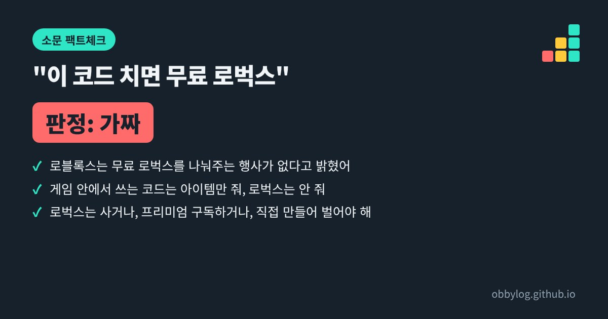

**판정: 가짜야.** 로블록스는 무료 로벅스를 나눠주는 행사를 하지 않는다고 공식 안내에 적어두고 있어. "이 코드를 치면 로벅스 1만 개", "아이디만 넣으면 로벅스 지급" 같은 건 전부 계정이나 개인정보를 노리는 거야. 게임 안에서 쓰는 진짜 코드도 있긴 한데, 그건 **아이템**을 주지 **로벅스**를 주지는 않아.

*이미지: 옵비로그*

## 소문은 보통 이렇게 와

- 영상이나 댓글에 "로벅스 코드 공개", "오늘만 되는 코드" 같은 제목이 붙어 있어.
- 사이트에 들어가면 **아이디만** 넣으라고 해. 비밀번호를 안 물어봐서 안전해 보이는데, 이게 첫 단계야.
- 아이디를 넣으면 "처리 중" 화면이 나오다가 마지막에 **사람 인증**, **설문 참여**, **앱 다운로드**를 하라고 해.
- "1시간 안에 안 받으면 사라짐"처럼 시간을 재촉해.

끝까지 해도 로벅스는 안 들어와. 대신 설문에 적은 개인정보가 넘어가거나, 깔라는 프로그램이 악성 프로그램이거나, 다음 단계에서 비밀번호를 받아 가.

## 근거 1: 로블록스가 직접 "없다"고 했어

로블록스 공식 사기 예방 안내에는 무료 로벅스를 나눠주는 공식 행사가 없다고 분명히 적혀 있어. 다른 사이트나 사용자가 무료 로벅스를 준다고 하면 개인정보를 훔치려는 거라고 보고, 대화를 끊고 신고하라고 해. 무료 프리미엄 멤버십이나 비싼 아이템을 준다는 제안도 마찬가지야.

그리고 로블록스는 **공식 로그인 화면 말고 다른 곳에서 비밀번호를 묻지 않아.** 비밀번호를 넣으라는 화면이 로블록스 주소가 아니면 무조건 가짜야.

## 근거 2: 진짜 코드는 아이템만 줘

게임 안에서 "코드 입력" 칸을 본 적 있을 거야. 이건 그 게임을 만든 개발자가 직접 뿌리는 코드고, 로블록스 규칙상 **그 게임에서 쓰는 아이템만** 줄 수 있어. 로벅스로 바꿀 수도 없고 현실 돈 가치도 없어야 해.

진짜 코드는 게임 설명란, 개발자의 공식 SNS 같은 공개된 곳에 올라와. 그리고 그 게임 안에서만 입력해. 외부 사이트에 입력하라는 코드는 진짜일 수가 없어.

## 근거 3: 로벅스 얻는 방법은 정해져 있어

로블록스 고객센터에 나온 공식 방법은 이게 전부야.

| 방법 | 설명 |
|---|---|
| 직접 구매 | 앱, 웹, 게임기에서 구매. 웹·PC나 기프트 카드로 사면 보너스가 붙을 수 있어 |
| 프리미엄 구독 | 매달 정해진 로벅스를 받아 |
| 아이템 판매 | 내가 만든 아바타 아이템을 마켓에서 팔아 |
| 게임 만들기 | 내가 만든 게임으로 로벅스를 벌어 |

기프트 카드도 가게나 공식 판매처에서 산 것만 진짜야. 모르는 사람이 "기프트 카드 코드 줄 테니 로그인 정보 알려줘"라고 하는 건 존재하지도 않는 코드로 꼬시는 거야.

이 중에 "공짜"는 없어. 로벅스는 결국 누군가 돈을 내야 생기는 거라서, 공짜로 퍼준다는 말이 성립하지 않아.

## 진짜 코드인지 30초 만에 구분하기

코드를 봤을 때 아래 중 하나라도 해당하면 가짜라고 생각하면 돼.

- **로벅스를 준다고 한다.** 진짜 코드는 로벅스를 줄 수 없어.
- **로블록스 밖 사이트에 입력하라고 한다.** 진짜 코드는 그 게임 안 입력 칸에만 넣어.
- **아이디, 비밀번호, 인증 코드를 같이 달라고 한다.** 코드 하나 쓰는 데 로그인 정보가 필요할 리 없어.
- **설문이나 앱 설치를 끝내야 받을 수 있다고 한다.** 공짜라더니 조건이 계속 붙으면 거기서 멈춰.
- **주소창에 뭘 붙여넣거나 즐겨찾기를 끌어다 놓으라고 한다.** 보안 업체 분석에 따르면 이건 로그인 상태를 통째로 빼가는 방법이야.

반대로 게임 설명란이나 개발자 공식 SNS에 올라온 코드를 그 게임 안에서 입력했는데 아이템이 나왔다면, 그건 진짜 코드야.

## 왜 이런 소문이 계속 돌까

- **로벅스가 갖고 싶은 사람이 많아서.** 이런 사기는 그 마음을 노려. 특히 "오늘만", "선착순"처럼 서두르게 만들면 생각할 틈 없이 누르게 돼.
- **아이디만 묻는 게 안전해 보여서.** 처음부터 비밀번호를 물으면 의심하니까, 단계를 잘게 나눠서 조금씩 끌고 가.
- **진짜 코드가 있다는 걸 알아서.** 게임 안 아이템 코드는 진짜로 있으니까, "로벅스 코드"도 있을 것 같은 착각을 이용해.

## 이미 입력했으면 이렇게 해

- **아이디만 넣었으면:** 그것만으로 계정이 넘어가진 않아. 그 사이트를 닫고 다시는 들어가지 마.
- **비밀번호나 인증 코드까지 넣었으면:** 바로 비밀번호를 바꾸고, 2단계 인증을 켜고, 복구 이메일이 바뀌지 않았는지 확인해. 그리고 부모님께 꼭 말해. 계정에 결제 수단이 연결돼 있으면 이상한 결제가 없는지도 부모님이 같이 확인해야 해.
- **뭘 깔았으면:** 그 프로그램을 지우고 부모님께 기기 검사를 부탁해.

혼날까 봐 숨기면 더 큰일이 돼. 이런 사기는 어른들도 많이 당하니까 바로 말하는 게 제일 빨리 해결하는 방법이야. 거래 사기나 채팅으로 오는 꼬임까지 한 번에 보고 싶으면 [로블록스 채팅·사기 예방 글](/parent/roblox-chat-settings-scam-guide/)을 부모님이랑 같이 읽어봐.

## 참고한 곳
- [Avoiding Frauds & Scams - 로블록스 공식](https://about.roblox.com/frauds-and-scams)
- [Ways to Get Robux - 로블록스 고객센터](https://en.help.roblox.com/hc/en-us/articles/203313200-Ways-to-Get-Robux)
- [Promo Offers for Virtual Rewards - 로블록스 고객센터](https://en.help.roblox.com/hc/en-us/articles/10549651908244-Promo-Codes-on-Roblox)
- [Looking for free Robux? Here's what's real, and what's a scam - ESET WeLiveSecurity](https://www.welivesecurity.com/en/kids-online/looking-for-free-robux-heres-whats-real-whats-scam/)
- [Roblox scam overview - Cisco Talos](https://blog.talosintelligence.com/roblox-scam-overview/)
