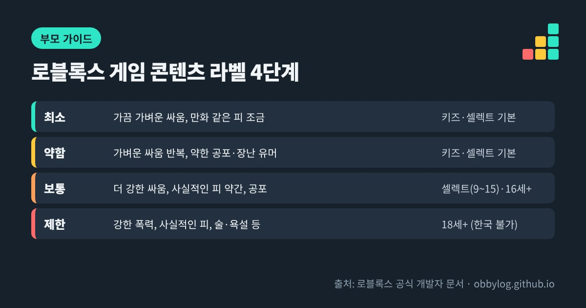

로블록스 게임은 인기 순위에 올라 있어도 아이 나이에 맞는다는 뜻은 아니에요. 게임마다 **최소·약함·보통·제한** 네 단계의 콘텐츠 라벨이 있고, 그 안에 **폭력, 피, 공포** 같은 세부 표시가 붙어요. 이 정보는 각 게임의 상세 페이지에서 볼 수 있고, 부모님은 자녀 보호 설정에서 허용 등급을 낮추거나 특정 게임만 따로 막을 수 있어요.

*이미지: 옵비로그 (로블록스 공식 개발자 문서 내용 정리)*

## 왜 지금 확인해야 할까요

이번 주 PC 동접 순위(11월 27일 아침 기준, Endgame Tools 집계)를 보면 12위에 마네킹을 총이나 도끼로 공격하며 물리 반응을 보는 게임이 올라와 있어요. 공략 사이트에 따르면 이 게임에는 **피와 폭력** 표시가 붙어 있어요. 아이들 사이에서 "요즘 이거 인기래" 하고 퍼지기 쉬운 자리예요.

로블록스는 많이 하는 게임을 홈과 순위 화면에 추천해 주는데, 이때 아이 나이대와 나라별 기준을 반영한다고 밝히고 있어요. 그래도 친구가 링크를 보내주거나 영상에서 보고 검색해서 들어가는 경우가 있으니, 부모님이 라벨을 읽을 줄 아시면 판단이 훨씬 쉬워져요.

## 네 단계 라벨, 무엇이 다른가요

로블록스 공식 개발자 문서에 정리된 기준이에요.

| 라벨 | 이런 내용이 들어갈 수 있어요 | 기본으로 볼 수 있는 계정 |
|---|---|---|
| 최소 | 가끔 나오는 가벼운 싸움, 만화 같은 피 조금 | 키즈(5~8세), 셀렉트(9~15세) |
| 약함 | 가벼운 싸움이 반복, 만화 같은 피 많이, 약한 공포, 가벼운 짓궂은 유머 | 키즈, 셀렉트 |
| 보통 | 더 강한 싸움, 사실적인 피 약간, 공포 장면, 화면에 보이기만 하는 도박 장면 | 셀렉트, 16세 이상 |
| 제한 | 강한 폭력, 사실적인 피 많이, 연애 주제, 술, 욕설 | 연령 확인한 18세 이상만 |

**제한 등급 게임은 한국에서는 아예 할 수 없어요.** 로블록스 문서에 한국이 제한 등급 이용 불가 국가로 적혀 있어요. 그래서 한국 아이들이 실제로 접할 수 있는 건 보통 등급까지예요.

여기서 눈여겨보실 부분은 **보통** 등급이에요. 9~15세 셀렉트 계정은 기본으로 보통 등급까지 열려 있어서, 초등학교 고학년 아이도 사실적인 피가 조금 나오는 게임을 할 수 있어요. 키즈·셀렉트 계정이 어떻게 나뉘는지는 [키즈·셀렉트 계정 정리 글](/parent/roblox-kids-select-accounts-guide/)에 자세히 있어요.

## 세부 표시는 이렇게 읽으세요

라벨 하나만 보지 말고 같이 붙은 세부 표시를 보시면 게임 분위기를 더 정확히 알 수 있어요.

- **폭력**: 얼마나 강한지와 얼마나 자주 나오는지를 함께 봐요. 결과가 사실적으로 표현되면 한 번만 나와도 등급이 올라가요.
- **피**: "만화 같은 피"와 "사실적인 피"로 나뉘어요. 사실적인 피가 많으면 18세 이상이에요.
- **공포**: 놀라게 하는 장면이 약한지, 보통인지, 자주 나오는지를 표시해요.
- **짓궂은 유머**: 트림이나 방귀 같은 장난은 약함, 그보다 센 표현은 보통이에요.
- **자유 창작, 소셜 모임**: 사용자가 마음대로 무언가를 만들 수 있는 게임이나, 모르는 사람과 어울리는 게 중심인 게임은 16세 이상이에요. 개인 공간이 있는 소셜 게임은 18세 이상이에요.
- **콘텐츠가 달라질 수 있음**: 이 표시가 붙은 게임은 연령 확인을 마친 16세 이상만 이용할 수 있어요. 구체적인 기준은 공식 문서에서 확인하지 못했어요.
- **유료 랜덤 아이템**: 돈을 내고 무엇이 나올지 모르는 뽑기가 있으면 개발자가 표시해야 해요. 결제 관리에 꼭 같이 보세요.

## 게임 페이지에서 확인하는 곳

라벨과 세부 표시는 각 게임의 **상세 페이지**에 나와요. 게임 썸네일을 눌러 들어가면 설명 부분에 표시가 보여요. 아이가 새 게임을 하고 싶다고 하면, 들어가기 전에 이 부분을 같이 보는 습관을 들이시면 좋아요.

한 가지 알아두실 점이 있어요. 나라별로 별도의 등급이 따로 붙을 수 있고, 이건 로블록스 자체 라벨과 다를 수 있다고 해요. 한국에서 보이는 표시가 해외 기사에 나온 것과 다르다면 이 때문일 수 있어요.

## 등급 낮추기와 게임 하나만 막기

부모 계정과 연결되어 있다면 두 가지를 할 수 있어요.

1. **허용 등급 낮추기**: 설정 → 자녀 보호 → 자녀 계정 선택 → 콘텐츠 제한 → 콘텐츠 등급에서 슬라이더를 내리면 돼요. 예를 들어 셀렉트 계정을 '약함'까지로 낮추면 보통 등급 게임이 막혀요.
2. **특정 게임만 막기**: 같은 메뉴의 **차단된 게임**에서 + 버튼을 누르고 게임 이름을 검색해 추가하면 돼요. 등급과 상관없이 막혀요. 다만 검색 결과에는 계속 보일 수 있고, 아이가 플레이 중일 때 막으면 다음 접속부터 적용돼요.

민감한 사회·정치·종교 문제를 주로 다루는 게임은 13세 미만에게 기본으로 막혀 있다는 것도 함께 알아두세요.

## 아이와 이야기할 때

"그 게임 하지 마"보다 "같이 라벨 한번 볼까?"가 훨씬 잘 통해요. 아이가 좋아하는 게임의 라벨을 함께 확인하고, 왜 이 게임은 괜찮고 저 게임은 아직 이른지 이유를 설명해 주세요. 친구들이 다 한다는 게임이 막혀 있으면, 부모님이 직접 한 판 해보고 판단하겠다고 약속하는 것도 좋은 방법이에요.

## 참고한 곳
- [Content maturity and compliance - 로블록스 크리에이터 문서](https://create.roblox.com/docs/production/promotion/experience-guidelines)
- [자녀 보호 기능 안내 - 로블록스 공식 (한국어)](https://about.roblox.com/ko/parental-controls)
- [Hyper Realistic Ragdoll guide - Allthings.how](https://allthings.how/?p=356463)
- [Roblox Charts - Endgame Tools](https://endgametools.com/en/roblox/charts)
